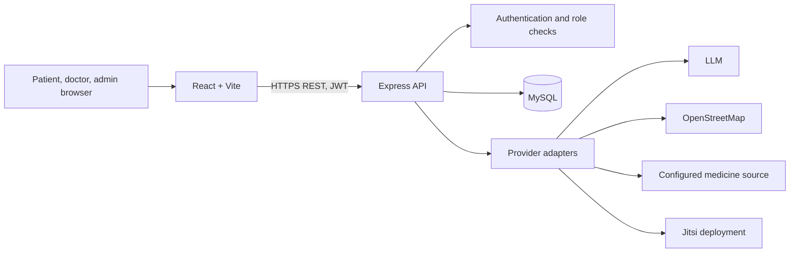

# Architecture

React routes provide the user experience; Express is authoritative for authorization. MySQL stores relational application data. Optional external services are backend-configured and return explicit unavailable responses when credentials are missing.

## Authentication flow

Registration validates fields, hashes passwords with bcrypt, and creates a patient or doctor record. Doctor records are pending verification. Login issues a time-limited JWT. Protected requests verify the token, role, account state, and resource ownership. Patient health data is available to the patient; doctor access requires recorded consent or an active accepted treatment appointment. Admin routes are limited to doctor verification and should be expanded only with audited, least-privilege workflows.

## Booking flow

The patient selects a published slot. The API starts a MySQL transaction, locks the slot row, verifies it remains available and belongs to an approved doctor, marks it unavailable, and creates the request. If the slot changed, the transaction fails cleanly. The doctor accepts or declines. A consultation record is created on acceptance.

## Data flow and privacy

Sensitive data stays in the API/database and is not embedded in frontend source. AI messages are stored for conversation continuity and sent to the configured provider only when an API key exists. The user should be told before using the feature and provider data handling must be reviewed before real health data is transmitted. Location is requested only after the user starts the SOS workflow; coordinates are stored only when permission and a location value are present.

## Database ER overview

See `database/schema.sql`. The core entities are users, patients, doctors, verification documents, availability slots, appointments, consultations, record grants, health records, prescriptions/items, nominees, emergency requests, reviews, notifications, chatbot messages, and audit records.
